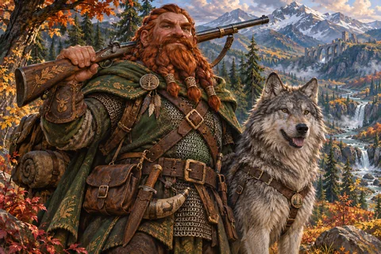
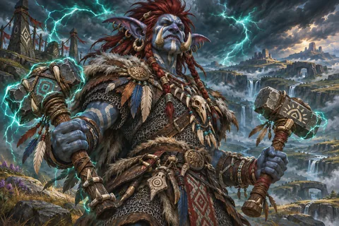

# WoW Forever Rotation

[Visit WoW Forever Rotation](https://wowforeverrotation.com/) to practice deciding which skill to use next in World of Warcraft: Forever. Choose a level 60 specialization, learn its opening moves at your own pace, then try a 60-second single-target encounter with the hints turned off.

## Choose a specialization

| [Arms Warrior](https://wowforeverrotation.com/arms-warrior-rotation/) | [Retribution Paladin](https://wowforeverrotation.com/retribution-paladin-rotation/) |
| --- | --- |
|  |  |
| Keep Rend on the target and watch for the brief window to use Overpower. | Store Seal of Command charges, switch seals, and land the hit that releases them. |

| [Frost Mage](https://wowforeverrotation.com/frost-mage-rotation/) | [Combat Rogue](https://wowforeverrotation.com/combat-rogue-rotation/) |
| --- | --- |
|  |  |
| Build Winter's Chill and decide when to spend the stacks with Cone of Cold. | Build combo points and decide when to refresh Slice and Dice or spend them on Eviscerate. |

## Inside the trainer

| [Feral Druid](https://wowforeverrotation.com/feral-druid-rotation/) | [Beast Mastery Hunter](https://wowforeverrotation.com/beast-mastery-hunter-rotation/) | [Enhancement Shaman](https://wowforeverrotation.com/enhancement-shaman-rotation/) |
| --- | --- | --- |
|  |  |  |
| Practice energy, combo points and bleed upkeep. | Reconnect your pet after a target change and maintain companions. | Watch maintenance timers and spend a full Maelstrom stack. |

Compare any two of the seven supported specializations in the [rotation comparison](https://wowforeverrotation.com/compare-rotations/), then try their lessons. Illustrated guides explain each exercise, common mistakes and what the simplified trainer leaves out.

- **Learn the opener.** Work through an untimed sequence. If you choose a skill too early, the coach explains which condition to watch.
- **Test yourself.** Tap the action bar or use the numbered keys shown on screen. The original four drills use simplified timing. Druid, Hunter and Shaman mechanics practice links each action to a base-spell reference, keeps source cooldowns and separates scenario controls from skills. Character resource inputs and profile limitations are visible before starting.
- **Check a change.** Each guide links to the relevant Blizzard notes so you can read the source behind a mechanic.

WoW Forever Rotation is an independent fan resource, unaffiliated with Blizzard Entertainment.
